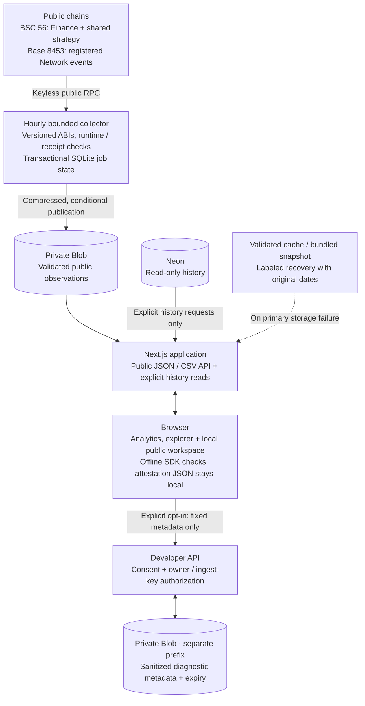

# PrimusScope

**Network analytics, task exploration and developer tools for the Primus ecosystem.**

PrimusScope helps users research public Primus activity, follow the objects that
matter to them, and diagnose SDK integrations while keeping attestation contents
in their browser. It brings Finance dashboards, zkTLS Network analytics, a
Task & Proof Explorer, a personal research workspace and local SDK checks into
one deployed application.

**[Open the live app on Vercel →](https://primus-scope.vercel.app)**

[Launch announcement + video on X](https://x.com/Natalia77351991/status/2120777410685632559)
· [Web video player](https://primusscope-video.vercel.app/)
· [Public API / OpenAPI](https://primus-scope.vercel.app/api/v1/openapi.json)
· [Sources & coverage](https://primus-scope.vercel.app/sources)
· [CI checks](https://github.com/mssystem1/PrimusScope/actions/workflows/ci.yml)

PrimusScope is an independent ecosystem project. It complements the
[official Primus dApp](https://dapp.primuslabs.xyz/) with research and developer
workflows; no Primus Labs partnership, endorsement or certification is implied.

[Primus Labs](https://primuslabs.xyz/) · [Official documentation](https://docs.primuslabs.xyz/)

## Why this matters for Primus

Primus connects verifiable data, confidential finance and application developers.
Understanding that ecosystem requires more than a transaction list: users need
to know what a metric measures, which contracts and dates it covers, and what
an attestor report or SDK result actually establishes.

PrimusScope is designed to make that evidence easier to use:

- **For users:** compare observed activity, inspect a task or batch, and return
  to saved public objects with a record of changes since their last review.
- **For researchers:** inspect metric definitions, exact source ranges and
  downloadable data behind charts, with missing history distinguished from zero.
- **For developers:** diagnose supported attestation formats, signer-version
  mismatches and application expectations without uploading proof contents.
- **For ecosystem teams:** review reproducible source definitions, SDK
  compatibility evidence and minimal diagnostic reports that can support
  integration discussions without requesting private user payloads.

The research experience includes interactive charts, scoped drill-down,
shareable selections, comparisons and CSV exports. Arbitrary SQL execution is
outside the current product scope.

## What is implemented

| Module | What users can do | Live link |
| --- | --- | --- |
| **Overview** | See separate Finance and Network scopes, source freshness and updates to saved public objects. | [Overview](https://primus-scope.vercel.app/) |
| **Finance** | Research U/eU and USDT/eUSDT route activity, observed batch lifecycles and the separately measured shared Unitas strategy. | [Finance](https://primus-scope.vercel.app/finance) |
| **zkTLS Network** | Explore requests, per-attestor reports, request cohorts, first-report latency, withdrawals and callback failures within covered ranges. | [Network analytics](https://primus-scope.vercel.app/network) |
| **Task & Proof Explorer** | Look up supported task IDs, transactions, registered contracts and batches; follow source evidence to task/batch detail views. | [Explorer](https://primus-scope.vercel.app/explore) |
| **Research workspace** | Save public objects and analytical views in this browser, check for source/object changes and mark changes as reviewed. | [Workspace](https://primus-scope.vercel.app/workspace) |
| **Local attestation inspector** | Run supported Core 0.3.9 or legacy Page Core 0.2.1 signer checks and separate recipient, request, context and age comparisons. | [SDK inspector](https://primus-scope.vercel.app/developers/verify) |
| **Developer Studio** | Create owned diagnostic projects, opt in to sanitized reports, inspect versions/outcomes/durations, rotate ingest keys, export, clear and delete data. | [Developer Studio](https://primus-scope.vercel.app/developers/apps) |
| **API and methodology** | Use the API playground, source links, contract/block/time coverage, collector status and metric definitions. | [Developer tools](https://primus-scope.vercel.app/developers) · [Sources](https://primus-scope.vercel.app/sources) |

### Finance: route operations and shared strategy economics

Finance starts with **BNB Smart Chain, chain 56**, and four registered Primus
aggregators covering **U/eU** and **USDT/eUSDT**. Route dashboards show observed
dispatch, finalization, cancellation and step activity. Batch details preserve
contract identity and original transaction links.

Both routes reference a shared underlying Unitas strategy. PrimusScope presents
that strategy once, with separate measurements for:

- **Assets / TVL in USDu units** and **sUSDu share supply**.
- **NAV / exchange price** per share.
- **7D and 30D APY**, calculated from historical NAV growth using actual elapsed
  time and eligible source anchors.
- **Public deposits, withdrawals and net flows**, with event identity, receipt
  checks and share-supply reconciliation.

`U/eU` and `USDT/eUSDT` remain the primary Primus routes. `USDu/sUSDu` describes
the shared strategy layer; its assets are not attributed to either route or to
an individual user. Public route-operation events do not expose deposit amounts.
Historical APY is not a forecast, private wallet return or the dApp's published
APY feed.

The retained public strategy baseline contains **61 daily samples and 4,098
receipt-checked flows across 60 days**, from 11 September to 10 November 2026.
New collection has its own watermarks. Gaps remain visible, and unreconciled
flow ranges are not published as empty activity.
See [dashboard formulas and provenance](docs/ANALYTICS_DASHBOARDS.md) and
[the historical reconstruction workflow](docs/STRATEGY_HISTORY.md).

### Network: explain the observed lifecycle

The separate Network source is a registered task contract on **Base, chain
8453**. Its dashboards distinguish task requests from individual attestor
reports and from sampled native task state. Reports are not counted as
independently verified proofs or protocol successes.

Users can filter by event type, task and inclusive block range; drill from a
chart interval into matching events; page through results; and export the same
selection as JSON or CSV. Snapshot-bound pagination and an explicit refresh
workflow handle source updates. Cohort and latency metrics state their source
window and exclusions. See [Network activity workflows](docs/NETWORK_ACTIVITY.md).

### Daily use and the Wallet Intelligence foundation

Save a task, batch, route or view, then return to Workspace. Review baselines
keep an observed change visible until it is acknowledged. Source revisions,
coverage changes and unavailable objects are shown separately from object-state
changes. Fixed-period comparisons require sufficient coverage on both sides.

This is the current foundation for Wallet Intelligence: **public research
preferences and saved-object review**. Private portfolio positions, confidential
balances and owner-authorized FHE decryption are not implemented. Checks run
when a page opens or the user requests them; there are no background alerts,
accounts or cross-device synchronization.
See [daily-use behavior and comparison rules](docs/DAILY_USE.md).

## Official Primus SDK integration

The inspector supports two explicit profiles:

| Profile | Integration and evidence |
| --- | --- |
| **Core 0.3.9** | An unchanged, source-pinned extraction of the official SDK verification method and encoding helpers, isolated from its Node/native runtime. A genuine signed reference published by Primus passes in Node and browser checks. |
| **Legacy Page Core 0.2.1** | The pinned official prototype method runs without constructing or initializing the client. Its older signer pin stays separate; the Core reference is correctly rejected under this profile. |

Both run in ephemeral offline Workers with `connect-src 'none'`. Attestation
JSON and expected values stay in tab/Worker memory. Clear, cancel and navigation
discard input and stop pending work. Reports omit proof input and expectations.

Developer Studio records only an opt-in projection of SDK/version, duration,
outcome/error codes and a random event ID. Project name/origin are separately
consented configuration. Owner cookies and scoped ingest keys control access;
new metadata uses a private Blob prefix separate from public observations.
Workspaces have up to three projects, at most 1,000 events per project and an
explicit expiry within seven days. Client-reported diagnostics are not
public Network statistics or authoritative proof evidence.

A signer match is a check against a version-pinned SDK address. Full zk-proof
computation, source-response revalidation, live revocation checks and replay
prevention are outside this inspector's scope. The complete Core Node/native
SDK is not presented as a browser-supported package import.

Technical references:

- [SDK workflows, privacy, API, expiry and integration guide](docs/SDK_TOOLS.md).
- [Core 0.3.9 provenance and source hashes](data/sdk/core-0.3.9.json) ·
  [Page Core 0.2.1 provenance](data/sdk/page-core-0.2.1.json).
- [Official Core SDK source](https://github.com/primus-labs/zktls-core-sdk) ·
  [official Page Core SDK source](https://github.com/primus-labs/zktls-page-core-sdk).
- [Primus's pinned signed reference](https://github.com/primus-labs/tip-contracts/blob/5945b4e45339fc3785a731d996b9b6273b2bff5b/test/fixtures/ClaimBySourceAttestation.sol).
- [Measured verifier / opt-in diagnostics example](examples/primus-verifier-diagnostics.ts).

## System overview



[Download diagram: SVG](docs/assets/primusscope-system-overview.svg) ·
[PNG](docs/assets/primusscope-system-overview.png)

The two Blob paths hold different classes of data: public chain observations
and private application diagnostic metadata. Raw attestation input has no path
to either store. Neon history is not copied into Blob.

**Stack:** Next.js / React, TypeScript, Node 24, Zod, viem / Ethers,
SQLite, Vercel Cron and private Blob, with Neon retained for history.

### Collection, serving and recovery

1. The collector reads bounded ranges from registered public RPC endpoints.
   Source definitions, recognized events, receipts, block identities and current
   implementation/runtime pins are checked before publication.
2. A job uses temporary SQLite to reuse the transactional reducer. A fenced
   conditional Blob write publishes completed validated ranges and checkpoints.
   Failed ranges preserve earlier coverage.
3. Next.js serves the stored, validated publication. Public page/API reads do not
   initiate RPC collection. Coverage, source time, attempts and lag stay distinct.
4. During a storage outage, a warm instance can serve its validated cache. A cold
   instance can serve the older bundled snapshot with a recovery notice and
   original dates. Quarantined observations remain blocked.

Neon is a separate read-only history source. At the 18 November 2026 review,
its historical reads remain quota-blocked; the current Blob app is available.
The new Finance/Network collection epoch begins at verified finalized blocks
from 17 November, while the retained strategy baseline has its own earlier
scope. This is a bounded observational release, not complete ecosystem history.

Capacity, provider quotas and finite job budgets can leave a visible backlog.
The publication currently has a 16 MB limit and a 100,000-event limit per domain.
RPC access is keyless for the demonstrated collection paths; Vercel hosting and
Blob still follow the account's plan/credits and limits. Historical archive-code
coverage and independent chain consensus are not established.
See [storage/recovery operation](docs/BLOB_RECOVERY.md) and
[hosted collection](docs/HOSTED_INDEXER.md).

### Repository map

| Location | Responsibility |
| --- | --- |
| [`apps/web`](apps/web) | Next.js screens, public/private APIs and SDK Worker entry points. |
| [`apps/collector`](apps/collector) | Authenticated Vercel Cron endpoint and invocation budgets. |
| [`apps/worker`](apps/worker) | Contract registry, bounded indexing, event/receipt checks and strategy reads. |
| [`packages/api-schema`](packages/api-schema) | Strict data, coverage and diagnostic contracts. |
| [`packages/data`](packages/data) | Metric derivation, comparisons, queries and serving modes. |
| [`packages/storage`](packages/storage) | SQLite, Blob and PostgreSQL adapters; publication and metadata boundaries. |
| [`data`](data) | Sanitized public observations, retained strategy evidence and SDK provenance. |
| [`vendor`](vendor) | Attributed, pinned Core verification extraction. |
| [`examples`](examples) | Verifier instrumentation and opt-in reporting integration. |
| [`docs`](docs) | Formulas, workflows, source evidence, deployment and operating limits. |

## Public API

The UI and API share the same schemas, analytics and publication. Start with the
[OpenAPI document](https://primus-scope.vercel.app/api/v1/openapi.json) or the
[interactive playground](https://primus-scope.vercel.app/developers).

| Resource | Endpoint |
| --- | --- |
| Overview | [`GET /api/v1/overview`](https://primus-scope.vercel.app/api/v1/overview) |
| Finance analytics | [`GET /api/v1/finance/analytics`](https://primus-scope.vercel.app/api/v1/finance/analytics) |
| Network analytics | [`GET /api/v1/network/analytics`](https://primus-scope.vercel.app/api/v1/network/analytics) |
| Filtered, paginated Network events | [`GET /api/v1/network/events`](https://primus-scope.vercel.app/api/v1/network/events) |
| Collector status / coverage | [`GET /api/v1/status/indexer`](https://primus-scope.vercel.app/api/v1/status/indexer) |
| Typed public identifier lookup | `POST /api/v1/explore/lookup` |
| Saved-public-object change checks | `POST /api/v1/workspace/check` |

The two POST resources above perform reads; they do not submit blockchain
transactions. CSV retains filters, event identities and provenance. Unsupported
or uncovered selections return explicit errors/unavailable values.

```sh
curl --fail --silent --show-error \
  'https://primus-scope.vercel.app/api/v1/finance/analytics?range=all&interval=day'

curl --fail --silent --show-error \
  'https://primus-scope.vercel.app/api/v1/network/events?limit=10'
```

Application-owned diagnostic endpoints are separate under
`/api/v1/developer/apps`; their cookie/key authorization and exact event contract
are documented in [SDK_TOOLS.md](docs/SDK_TOOLS.md).

## Review the product in five minutes

1. Open [Finance](https://primus-scope.vercel.app/finance), compare the Primus
   routes with the shared strategy section, change dates and inspect chart data.
2. Open [Network](https://primus-scope.vercel.app/network), drill from a chart
   into matching events, then inspect a task or transaction source link.
3. Save a public object/view and open
   [Workspace](https://primus-scope.vercel.app/workspace) to see review tracking.
4. Open the [local inspector](https://primus-scope.vercel.app/developers/verify),
   load the explicitly self-signed rejection example and run checks. For the
   genuine Core positive reference, use the linked source and reproducible test
   command below, or inspect your own supported JSON locally.
5. In [Developer Studio](https://primus-scope.vercel.app/developers/apps), create
   a temporary project, opt in from the inspector, inspect sanitized reports,
   then clear/delete the project. Check
   [Sources](https://primus-scope.vercel.app/sources) for scope and limitations.

## Run locally

Use **Node 24 and npm 11**. The default local mode uses sanitized recorded
observations; public views and local SDK checks need no wallet, database,
Primus app secret or additional account.

```sh
npm ci --cache .local/npm-cache
node scripts/build-sdk-worker.mjs
npm run dev
```

For a local production build:

```sh
npm run build
npm run start
```

Hosted collection and private diagnostics use separate server-side configuration;
starting recorded mode does not provision those services. See the consolidated
[environment checklist](ENVIRONMENT_SETUP.md),
[local indexing guide](docs/LOCAL_INDEXER.md) and
[Vercel deployment guide](docs/DEPLOYMENT.md). Discovery tools optionally use a
host-scoped `ETHERSCAN_API_KEY` for supported metadata reads. Never commit real
keys or expose them through `NEXT_PUBLIC_*` variables.

`npm run data:import` rebuilds the recorded artifact from retained discovery
evidence. A recorded production server must be rebuilt/restarted to include a
new artifact; importing does not refresh its source timestamps automatically.

## Validation and reproducibility

The implemented SDK/application release
[`46bfa57`](https://github.com/mssystem1/PrimusScope/commit/46bfa5726bca138c399fd5e2cc5bb39bf8919084)
passed the following checks, with
[the exact CI run available here](https://github.com/mssystem1/PrimusScope/actions/runs/44157217066):

| Evidence | Result |
| --- | --- |
| Unit / integration checks | **290 passed** across schemas, analytics, persistence, authorization, workers and SDK behavior. |
| Official signed-reference checks | **8 groups passed**: genuine Core positive, legacy rejection, tampering, policy/format checks and sanitized reporting. |
| CI browser checks | **72 passed**: 64 recorded-mode, five isolated indexed-mode and three storage-outage checks. |
| Live HTTPS checks | **19 passed**: API, source disclosure, both SDK profiles, owned diagnostics lifecycle, privacy, desktop/phone layout and automated accessibility. |

Local checks, synthetic failure cases and deployed checks are distinct evidence.
Automated accessibility tests do not replace broader user testing. The genuine
reference is downloaded from a pinned public Primus source for tests; its raw
payload is not shipped in the application or committed here.

```sh
npm run test:sdk-positive
npm run typecheck
npm test
npm run build
npm run build:collector
npm run test:e2e
npm run test:e2e:indexed
npm run test:e2e:recovery
```

For the configured production deployment:

```sh
E2E_DATA_MODE=blob E2E_BASE_URL=https://primus-scope.vercel.app npm run test:e2e
```

The live suite creates only temporary diagnostic projects and removes them in
cleanup. Credentials, owner cookies and proof input are excluded from its
artifacts. See [testing procedures](docs/TESTING.md),
[implementation status](docs/IMPLEMENTATION_STATUS.md) and
[data readiness evidence](docs/discovery/DATA_READINESS.md).

## Collaboration with Primus Labs

PrimusScope offers a working ecosystem contribution: public analytics with
explicit provenance, task explainability, source/version compatibility evidence
and developer diagnostics that avoid collecting private proofs.

The most useful collaboration would be technical review and integration guidance:

- A canonical production contract/ABI registry, deployment boundaries and
  upgrade notifications for supported Finance and Network sources.
- Supported verification-only SDK entry points, versioned attestation formats,
  signer-rotation guidance and public regression fixtures.
- Guidance on safe aggregate publication and any supported owner-authorized
  FHE read flow before private wallet features are built.
- Feedback on which analytics and diagnostic workflows are most useful to
  ecosystem users and developers.

These are requests for possible collaboration, not claims of access or support.
Broader history, private portfolio intelligence and further SDK modes require
validated integrations before being presented as available features.

**Builder and updates:** [@Natalia77351991](https://x.com/Natalia77351991)
· [PrimusScope launch post + video](https://x.com/Natalia77351991/status/2120777410685632559)
· [Live Vercel application](https://primus-scope.vercel.app)

For the original product rationale, see the
[planning package](docs/planning/README.md). It is a historical planning baseline;
the implementation, linked source evidence and current coverage take precedence.
