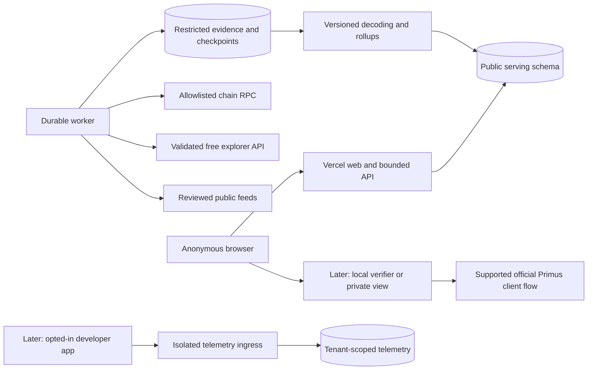

# Architecture and data foundation

Current source priority: BSC Finance, Etherscan V2 chain 56, as recorded in [decision 11](11-bsc-finance-first.md). The public serving/worker/privacy architecture remains applicable; the earlier Base RPC decision below is historical rather than the active ingestion requirement.

## Decisions and deployment

Current data-source decision: the user selected Base with bounded free RPC reads (path 1). [Decision 10](10-free-data-sources.md) retains the $0-data constraint and excludes paid Base explorer access. The [executable discovery probe](../discovery/README.md) tests identity, small log ranges, receipts and state without purchasing service. No live capacity/history approval is established yet; future explorer adapters are optional.

Use a TypeScript modular monolith with a dedicated indexing process. Proposed tools: Next.js web/API, Viem chain reads, managed PostgreSQL, Drizzle for typed schema/migrations, Zod/OpenAPI contracts, TanStack Query for interactive charts, Recharts for initial charting, Vitest and Playwright. Select maintained mutually compatible releases and pin them at implementation time; this plan has not installed or tested versions.

**Vercel:** public pages, bounded API handlers, static assets and cache integration. No infinite indexer loop, historical backfill inside a request, persistent local files or custom decryption service. The web can be deployed on Vercel while Postgres and the durable worker run elsewhere.

**Worker:** one persistent Node.js process initially, with bounded jobs, leases, restart recovery and source adapters. Provider choice can follow budget and availability; Railway/Render/Fly/VPS are options, not configured services. Postgres job/checkpoint tables suffice initially. Add a separate queue only for a demonstrated operational need.

**Database:** separate restricted evidence, public read models and later tenant telemetry. Vercel uses pooled, least-privilege serving credentials; the worker uses scoped writes; migrations use a separate role. Keep web, worker and database regions close. Preview and staging do not write production cursors.

Repository shape at implementation: `apps/web`, `apps/worker`, `packages/api-schema`, `packages/db`, `packages/metrics`, `packages/primus-adapter`, `packages/contracts`, `tests/e2e`, `docs` and `infra`. Do not create unused packages solely to match a diagram.

## Four trust boundaries

1. **Public source evidence:** allowlisted chain events, reads and official public feeds. Public chain data may still contain sensitive subjects or arbitrary hostile strings; raw payloads are not automatically republished.
2. **Public serving data:** strictly projected, reviewed fields and versioned aggregate metrics. UI/API/export share the same publication policy.
3. **Owner-private browser state:** supported official authorization/decryption only; no decrypted values, keys, permits or private proofs reach PrimusScope servers, logs or analytics. Inspect the official flow's actual network behavior before promising its topology.
4. **Developer telemetry:** application-owned, opt-in and isolated from public ecosystem totals. Tenant data has separate authentication, quotas and retention.

No public API proxies arbitrary RPC calls or third-party URLs. External node metadata and feed URLs require allowlisting and SSRF controls. No secret values in repository manifests.

## Source registry and capability model

A contract source record contains: chain/environment, address, role, deployment block, official source reference, code hash, proxy type, historical implementations, ABI hash and block intervals, semantic-mapping version, supported metric IDs, review status/date/reviewer, finality-policy ID and publication-policy ID. A source can be `discovery_candidate`, `live_verified`, `approved`, `quarantined` or `disabled`.

Keep source existence, deployed compatibility and publication permission separate. An address in a PDF is a discovery candidate. An SDK ABI is not proof of the same deployed ABI. A deployed contract can be dormant without implying the ecosystem is unused.

Capabilities are source-scoped: event request history, native-state snapshots, report fees, batch lifecycle, published yield history and local owner-read support. UI navigation and APIs consume this capability registry so unsupported features are gated consistently.

## Ingestion and recovery

1. Verify RPC chain ID and source configuration. Acquire a per-chain/contract/range lease; a second worker cannot race the same checkpoint.
2. Find eligible bounded ranges, adapting `eth_getLogs` size to provider limits. Persist successful scanned intervals and explicit gaps; the maximum scanned height alone cannot prove completeness.
3. Store immutable event/block observations with chain ID, block/transaction hashes, log index, topics and source registry version. Keep canonical mapping separately so reorg metadata can change without overwriting observed evidence.
4. Decode against the ABI effective at that block. Unknown implementations or decoding failures raise source incidents and pause affected metrics rather than silently dropping events.
5. Project sanitized domain facts. Request, attestor report and native task-state observation are distinct records. `queryTask` may return sensitive task-result fields; request only supported data and project state summaries without persisting full proof bodies.
6. Enrich receipts and timestamps with independent retry state. Upsert canonical facts and cursor updates transactionally. Apply chain-specific finality policy.
7. Recompute affected buckets deterministically under a methodology version. Publish a read-model watermark only after all required source work is complete. Cache keys include that version/watermark.
8. Continuously verify recent canonical ancestry. Orphaned facts invalidate related snapshots and rollups. Deep reorg recovery can reset to a trusted checkpoint and replay; a fixed 20–50-block window is not a universal guarantee.

Finality policies must distinguish observed, safe and finalized semantics for the actual chain/provider. L2 sequencer confirmation is not identical to L1 economic finality. Status reports chain-finality delay separately from indexer lag. Head reads with inconsistent snapshots must not populate finalized historical charts.

## Task semantics from inspected official SDK source

Canonical key: `(chainId, taskContract, taskId)`, with `taskId` validated as the supported version's bytes32 identifier.

- `SubmitTask`: one request with multiple assigned `attestors` possible.
- `ReportResult`: one attestor report, not a success flag or one completed task.
- Native task states include `INIT`, `SUCCESS`, `PARTIAL_SUCCESS`, `PARTIAL_SUCCESS_SETTLED`, `FAILED`. Store raw native state and a versioned display mapping. Do not infer terminal semantics merely from names.
- `WithdrawBalance` can carry several task IDs and statuses. Balance withdrawal and per-task fee realization require careful mapping.
- `CallbackFailed` is a callback-execution observation, not automatically proof failure.

Task-state reads are block-pinned observations, with an as-of block and provenance. If transitions are only discovered by polling, record an observation interval; do not invent exact settlement time. Historical outcomes may require archive access or validated event reconstruction. No-report and unknown states are not automatic failure.

## Canonical model

| Entity | Identity and important contents |
| --- | --- |
| Chains/contracts/ABI versions | Reviewed identity, chain-specific finality, effective block ranges and capabilities |
| Blocks/log observations | Immutable source observations and ingestion metadata |
| Canonical block map/scanned ranges | Current canonical chain plus contiguous coverage and gaps |
| Network requests | Chain/contract/task key, safe submitter field, submission block/time, assigned attestors |
| Attestor reports | Task key, report identity, attestor and verified fee fields with units |
| Task-state observations | Native status, pinned block, observed time/interval and mapping version |
| Attestor registry observations | Protocol registry state with source, not invented uptime/stake |
| Finance vault/batch records | Curated identities and reviewed public state only; no participant enrichment |
| Yield observations | APR/APY definition, components, source/applicable/fetch times, payload hash, adapter version |
| Metric buckets | Scope, unit, decimal value/null, coverage, methodology and publication versions |
| Incidents/manifests | Source outages, corrections, upgrade quarantines, evidence and review |

Represent EVM integer base units with `NUMERIC(78,0)` and explicit asset decimals. A generic `NUMERIC(78,18)` field has only 60 integer digits and is unsuitable for arbitrary uint256 values. Rate/ratio storage has its own scale and definition. Use decimal strings over JSON; avoid JavaScript floating-point accounting. Store UTC timestamps and half-open bucket boundaries.

Addresses use canonical binary/lowercase identity; checksummed form is display only. All uniqueness and rollup keys include chain, contract scope and relevant methodology. Never deduplicate users across chains by assuming an address is a person.

## Finance ingestion and publication

The official-hosted audit gives useful source candidates and event clues, not an approved live registry. Validate current code, implementations, complete ABI, assets/decimals, strategy identity and actual events before enabling a finance adapter.

Keep official published APY observations distinct from independently computed share-price return and depositor return. If history is absent, a series can start when collection starts; it cannot be backdated. Public strategy balances require attribution/reconciliation before being called Primus assets, and disclosure review before any chart.

Privacy approval applies to the combination of charts, filters, buckets, exports and caches. No reserve differencing, participant graph or per-wallet confidential timeline. Do not assume a nominal cohort threshold proves privacy. Initial scope excludes aggregates made from private user contributions.

## Operational design

- RPC outages: bounded retry/backoff, failover only to the same verified chain, retain last trustworthy watermark and mark stale.
- ABI upgrade: quarantine affected decoder/metrics, preserve observations, review historical mapping and replay before republishing.
- Feed drift: reject/quarantine invalid observations; keep last-known value with original time and incident label.
- Correction: version methodology, replay affected ranges, invalidate caches/exports and expose a correction notice.
- Sensitive publication incident: feature disable plus cache purge, including share/export endpoints; no long-lived public cache that defeats takedown.
- Recovery: tested backup restore, worker restart/checkpoint recovery and deployment rollback. Frontend rollback cannot reverse a database migration.

Monitor source watermark, scan gaps, decode failures, worker heartbeat, queue age, DB pool pressure and API latency. Redact search identifiers, full URLs, proof content and wallet values at application, edge, proxy, error-monitoring and analytics layers.

Cost planning includes web runtime/bandwidth, worker uptime, Postgres/PITR/storage, primary/fallback RPC and archive access, monitoring and later notification/telemetry volume. Estimate using measured event density, request range limits and backfill size after discovery. Do not promise free continuous analytics or choose multi-chain scale before those measurements.
