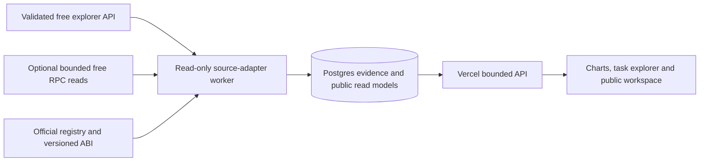

# Environment variables and on-chain data access

**Current configuration superseding the original Base runbook below:** BSC Finance uses Etherscan V2, chain 56. Create only `ETHERSCAN_API_KEY` in secure environment settings and allow `api.etherscan.io`. No local template-file edit is required. See [the current BSC decision](11-bsc-finance-first.md); older RPC/database stages below are future/reference material.

Proposed configuration and next-action runbook, 8 November 2026. No application or indexer is implemented yet. The root [.env.example](../../.env.example) defines proposed variable names, not an already functioning configuration loader.

## What is needed first

Current user choice: **path 1, Base with bounded free RPC**. [Decision 10](10-free-data-sources.md) records the history; the [discovery runbook](../discovery/README.md) describes the executable probe. No database, explorer API key, wallet, private key, Primus app identity or Vercel deployment token is needed for this first trial. Explorer adapters remain optional for later eligible sources.

`https://mainnet.base.org` can be a keyless endpoint for small optional Base state/code/finality probes. Do not assume it supports ongoing backfill or historical contract state. If the free explorer lacks a needed read, validate an appropriate free public RPC route or gate the metric. Historical logs and historical contract state are different capabilities. A paid managed provider is not an MVP prerequisite or an automatic fallback.

Current observations: none of the proposed RPC/database variables were set in the cloud process, and environment status reported no configured secret/runtime-variable bindings. A JSON-RPC `eth_chainId` probe to the public Base endpoint failed at the proxy tunnel with `403 Forbidden`; no chain response was obtained. Direct Primus docs/dApp access was likewise blocked previously. This is not an RPC/Primus outage claim.

Required domain additions include `docs.primuslabs.xyz` and `dapp.primuslabs.xyz`, plus candidate data-provider documentation/API hosts for evaluation. Current probes to `docs.etherscan.io`, `api.etherscan.io` and `base.blockscout.com` were policy-denied, so they provide no live plan/endpoint result. Add `mainnet.base.org` only if evaluating Base RPC. Database destinations follow provider selection. Preserve existing entries. The configuration-draft read still returned an error, so no network/credential change is claimed saved or applied. After settings change, verify status and make a fresh request.

## Configuration by stage and runtime

| Variable | When | Where | Handling |
| --- | --- | --- | --- |
| `CHAIN_EXPLORER_API_URL` | Optional future adapter; not this Base trial | Cloud discovery and worker | Reviewed provider host; never caller-supplied URL |
| `ETHERSCAN_API_KEY` | Only for a later verified free source; not required now | Discovery and worker | Never browser-exposed |
| `BASE_RPC_URL` | Selected Base bounded-read trial | Cloud discovery and worker | Defaults to keyless `https://mainnet.base.org`; credential-bearing URLs remain sensitive |
| `BASE_RPC_FALLBACK_URL` | Reliable ingestion | Worker | Optional different provider; verify chain ID and supported history |
| `WEB_DATABASE_URL` | Web/API vertical slice | Vercel server runtime | Pooled, read-only role over approved public serving views/schema |
| `WORKER_DATABASE_URL` | Persisted ingestion | Durable worker | Least-privilege writes for evidence/checkpoints/read-model updates |
| `MIGRATION_DATABASE_URL` | Schema deployment | Controlled migration process | Provider-supported migration connection; not exposed to web requests |
| `BNB_RPC_URL` | Finance discovery/ingestion | Discovery and worker | Later, after source candidates are reviewed; BNB task contracts and finance contracts are different |

Keep real values in secure environment settings. Never paste keys into chat or commit `.env` files. The example contains no credentials. Never prefix RPC or database credentials with `NEXT_PUBLIC_`; that exposes them to the browser build. Contract addresses, chain IDs, ABI hashes, deployment blocks and semantic mappings belong in the reviewed versioned registry, not an unreviewed environment-variable override.

Configure each runtime separately: cloud settings support research/development; Vercel settings support deployed web/API; worker-host settings support ingestion. Values do not automatically propagate between them. Separate preview/staging and production databases and credentials. Vercel linking/CI authentication is a later deployment prerequisite and is not evidence of chain access.

Use the database provider/platform's supported TLS and authentication path. HTTP proxy-injected secret placeholders are not necessarily raw database passwords usable in a Postgres connection. Database TCP access may need a supported forwarding route/grant; an HTTPS database API requires its own approved endpoint and appropriate driver. Test the actual connection without printing the URL/password.

## How public chain data reaches the UI

The worker uses explorer pagination and HTTPS polling, avoiding assumptions about WebSocket support. It caches/reuses fetched data across users. Viem handles the optional RPC adapter and ABI decoding. The indexer does not sign transactions. The browser receives bounded public analytics from our API; it does not need provider credentials or raw proof responses.

| JSON-RPC method | Purpose and validity check |
| --- | --- |
| `eth_chainId` | Verify Base `8453` / `0x2105`; reject a wrong-chain endpoint |
| `eth_getCode` | Confirm code exists at candidate contracts and relevant implementation addresses |
| `eth_getStorageAt` or supported proxy reads | Resolve known proxy type/implementation; do not assume every contract uses the same storage slot |
| `eth_getLogs` | Retrieve only registered address/event ranges, in bounded adaptive chunks |
| `eth_getBlockByNumber` | Block time, ancestry and validated safe/finalized watermarks |
| `eth_getTransactionReceipt` | Event/transaction linkage and fee components where exposed |
| `eth_call` | Supported reads such as `queryTask`, pinned to an eligible block |

Official ABI source tells us how to decode bytes; deployed code, implementation history and real observations establish whether that ABI is correct for the selected block. The official SDK can support compatible reads and verification adapters; public log access itself comes from standard EVM RPC and does not require a Primus API key. No SDK reveals encrypted values merely because it can read ciphertext on-chain.

Store requests, per-attestor reports and native state observations separately. Historical state reads may require archive access. A latest `queryTask` response does not reconstruct an earlier completion time; polling only bounds when a change was observed. Apply chain-specific finality, deduplication, reorg replay, scan-gap tracking and source metadata before counting finalized metrics.

## Concrete next steps and exit evidence

The current executable path is the [Base free-RPC discovery runbook](../discovery/README.md). The broader provider comparison below remains applicable only to future adapters or a separately chosen fallback; do not silently switch away from the user's selected path.

1. Enable candidate documentation/API host access. Verify the free chain/endpoint entitlement and API quota before selecting Etherscan, Blockscout or another explorer. Configure only the selected source; no paid fallback.
2. Inspect current official docs/dApp and confirm candidate task/node deployments on a free-supported chain, implementation identities and ABI/deployment versions. Obtain deployment blocks and source references; an audit or SDK address is only a discovery seed.
3. Fetch a bounded real task sample through complete explorer pagination: one request, all available reports and receipt/block references. Add a free supported state read only if available; otherwise keep native outcomes unknown. Record limitations without storing raw private proof data.
4. Write the approved event/state/fee mapping and fixture. Include partial outcomes and distinguish callback failure from proof/task failure. Establish which historical charts are actually supportable.
5. Provision managed Postgres with separated roles; implement one replayable worker slice and one typed API/task screen. Verify source-to-screen correctness before scaling charts or chains.
6. Deploy the web/API to Vercel with staging data and the durable worker separately. Run the deployed workflows in document 06, then perform non-destructive production smoke tests.

Finance/APY and owner-private integration continue as independent discovery tracks. They do not block learning from a real Network slice, and they are not considered delivered by rendering unavailable placeholders.
